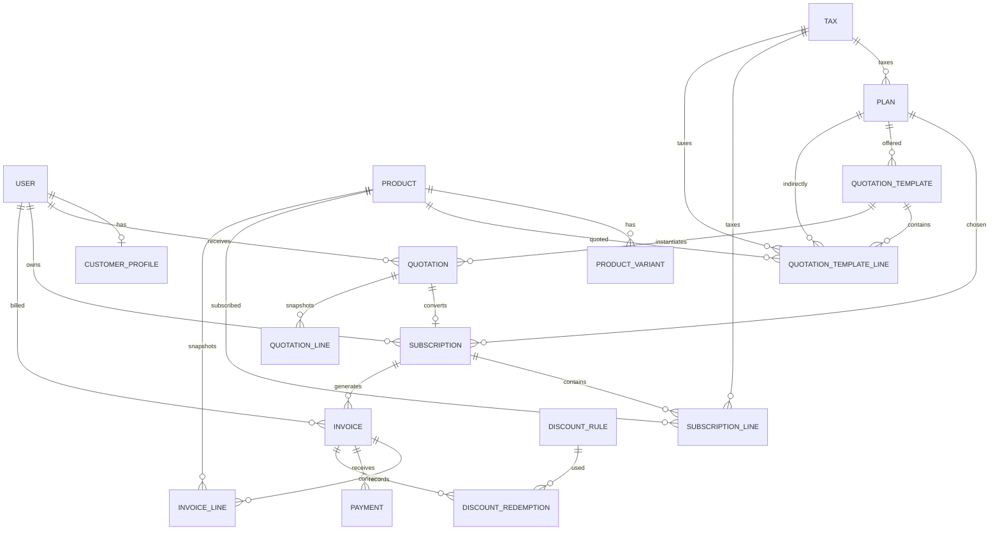

# Schema overview

## Main relationships

## Billing interpretation used by this starter

- `Plan.price` is the recurring base fee and is included once in each billing-period invoice. `Plan.tax` is optional.
- `SubscriptionLine` represents additional billable products/add-ons. Their direct-subscription unit price is derived from product sale price plus variant adjustment.
- Quotation template lines can contain agreed/negotiated unit prices; conversion preserves those prices.
- Invoice lines are immutable price/tax/discount snapshots. Later catalogue edits do not rewrite historical invoices.
- One best eligible discount is applied per invoice; discount stacking is intentionally excluded from the hackathon baseline.

## Ownership boundaries

- `accounts`: User and customer profile. Other apps FK to `settings.AUTH_USER_MODEL`.
- `catalog`: Product, ProductVariant, Tax, Plan.
- `subscriptions`: QuotationTemplate, Quotation, Subscription and line items.
- `billing`: DiscountRule, Invoice, InvoiceLine, DiscountRedemption, Payment.
- `dashboard`: read-only aggregates over the other apps.
